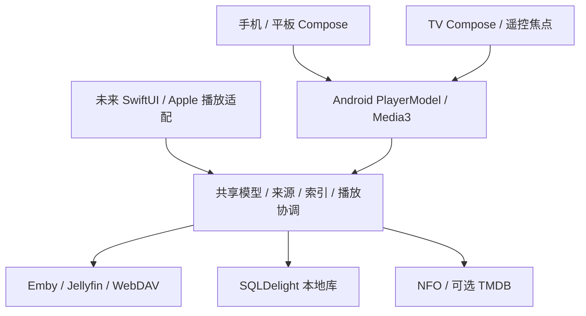

# 架构决策：共享业务，平台播放与交互

## 选择依据

原项目是单模块 Android 客户端，播放器业务约 792 行，把 Media3、Peach JSON、字幕转换、时间轴和进度上报放在同一控制器中。直接复制播放器文件会继续依赖 Peach 服务，也无法编译到 Apple。

新项目把「来源 → 播放计划 → 平台引擎 → 播放事件」作为主链。KMP 共享媒体身份、协议、XML/NFO、索引、匹配和会话协调；平台负责解码、画面、凭据与输入。

## 模块职责与接口

`shared` 按业务包组织，避免先拆成大量空模块。它依赖 Ktor、SQLDelight、xmlutil，但不引用 Android/Media3/JSONObject。`playback-media3` 实现 Android 引擎、凭据和应用协调。`ui-mobile` 与 `ui-tv` 分别实现触控、自适应网格和 TV 遥控界面；两个 app 仅负责平台入口。`apple-probe` 验证 SwiftUI 访问 KMP 模型。

- `MediaId(sourceId, value)`：来源实例是身份的一部分，同一个服务器的两个账号也使用不同实例。跨来源不自动合并媒体或进度。
- `MediaSourceProvider`：认证、浏览、详情、解析播放计划、播放上报和会话释放。来源能力用于交互选择，禁止所有来源假装支持服务器转码。
- `PlaybackPlan`：媒体、资源地址、字幕、播放方式、凭据引用、服务器会话和起播位置；不保存明文口令。
- `PlaybackEngine`：播放命令与 `StateFlow<PlaybackState>`。Media3 对象仅留在 Android 层。
- `PlaybackCoordinator`：串行 START/PROGRESS/STOP、周期性本地进度、关闭转码会话。远端失败不重复累计；保留本地记录并告知上报失败。
- `MetadataProvider`：搜索和详情，不直接修改来源数据。`CredentialStore`：平台安全存储接口。

新增来源：实现 provider，映射统一模型和播放计划，在 `SourceRegistry` 注册工厂，再添加独立协议契约测试。先用编译期扩展，动态插件 ABI、签名和沙箱留到有第三方需求时设计。

## 多源和认证

Emby 和 Jellyfin 分别使用适配器，明确共享的 REST 操作放在内部基类；Emby 的 `/emby` 前缀和反向代理子路径单独处理。以服务器返回能力和真实设备解码器列表协商播放，不能把所有 MKV 或 HDR 都声明为设备支持。`DeviceProfile` 当前仅针对检测到的 AVC/HEVC 与音频组合生成保守声明，完整 profile/level/HDR/分辨率条件仍需实服补充。

Ktor 来源请求禁用自动重定向，并在发送认证前检查 origin。WebDAV 根据挑战选择 Basic/Digest。Media3/Coil 的 OkHttp 网络拦截器对每次实际网络请求重新检查 origin，跨站移除 Authorization 和自定义 token；Digest 媒体请求支持 MD5 与 qop=auth，不支持的算法明确失败，不绕过 TLS 校验。

服务器签名的播放 URL 可能包含临时参数，产品不输出 URL 或完整网络异常。诊断仅记录无媒体身份的耗时。生产化前仍需对三方库日志和代理行为做专项验证。

## WebDAV 索引与元数据

目录和海报墙引用同一媒体身份，SQLDelight 保存索引、人工匹配、位置、扫描队列及连接描述；凭据不进入数据库。

扫描逐目录 PROPFIND Depth=1，单目录最多两个媒体资料任务并发。视频、NFO、海报的 ETag/大小/修改时间构成指纹；指纹未变跳过资料重读。队列完成后才移除目录；取消与目录失败保留队列。只有成功完整枚举的目录才清理该目录缺失的视频。删除的整棵目录、外部移动的媒体需要后续全库一致性回收；当前不会因为一个失败目录清空全库。

默认只读本地 NFO 和图片。用户开启 TMDB 后，自动电影匹配仅接受唯一且标题/年份符合的结果；模糊结果不擅自匹配。剧集按名称、季、集分组，可手动选系列。人工结果独立保存，取消匹配也保留抑制自动匹配的记录。TMDB 失败不影响本地播放。

首版以用户自有 token 接入，不内置项目密钥。公开发行前补齐 TMDB 官方 logo、条款确认和实际联网验收。

## 已比较的开源实现

| 候选 | 结论 | 已检查证据 |
|---|---|---|
| Media3 | 当前 Android 引擎 | 原项目已集成；本项目构建与合成样片播放 |
| Jellyfin Kotlin SDK | 协议参考，不放入共享核心 | 官方 README 与 Gradle 源码当前只提供 JVM/Android target |
| Jellyfin Android TV | TV/协议实践参考，不整体 fork | 官方原生客户端围绕 Jellyfin 服务模型 |
| Swiftfin | Apple 原生交互与 VLC 兼容路线参考 | SwiftUI iOS/tvOS 客户端，公开描述 Native/VLC 播放差异 |
| Flutter + media-kit | 暂不选 | 会重写现有 Kotlin 交互，tvOS 需额外支持验证 |
| mpvKt / libVLC | 后续引擎补强候选 | 广格式能力有吸引力，但增加 NDK/ABI/包体和会话桥接成本 |
| dav4jvm / KMP fork | WebDAV 行为参考 | 主库为 JVM，KMP fork 文档与发布成熟度需要额外验证；当前以成熟 HTTP/XML 库实现只读子集 |

参考：[KMP 平台支持](https://kotlinlang.org/docs/multiplatform/supported-platforms.html)、[Jellyfin SDK](https://github.com/jellyfin/jellyfin-sdk-kotlin)、[SDK target 源码](https://github.com/jellyfin/jellyfin-sdk-kotlin/blob/master/jellyfin-api/build.gradle.kts)、[Media3 格式](https://developer.android.com/media/media3/exoplayer/supported-formats)、[TV Compose](https://developer.android.com/training/tv/playback/compose)、[Emby REST](https://dev.emby.media/doc/restapi/index.html)、[Swiftfin](https://github.com/jellyfin/Swiftfin)、[media-kit](https://github.com/media-kit/media-kit)、[mpvKt](https://github.com/abdallahmehiz/mpvKt)、[dav4jvm](https://github.com/bitfireAT/dav4jvm)、[Ktor 平台](https://ktor.io/docs/client-supported-platforms.html)。这些是选型资料，不代表本项目已经集成所有候选。
